# FurFiles

A self-hosted record keeper for the pets in your household: vet visits and
what they cost, vaccinations, medications and ongoing care, allergies,
weights, insurance, contacts, and the reminders that fall out of all of it.
Think [LubeLogger](https://github.com/hargata/lubelog), but for pets instead
of cars.

<p>
  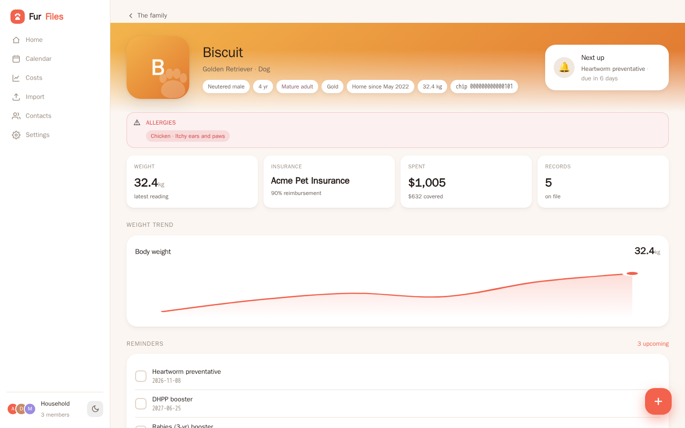
  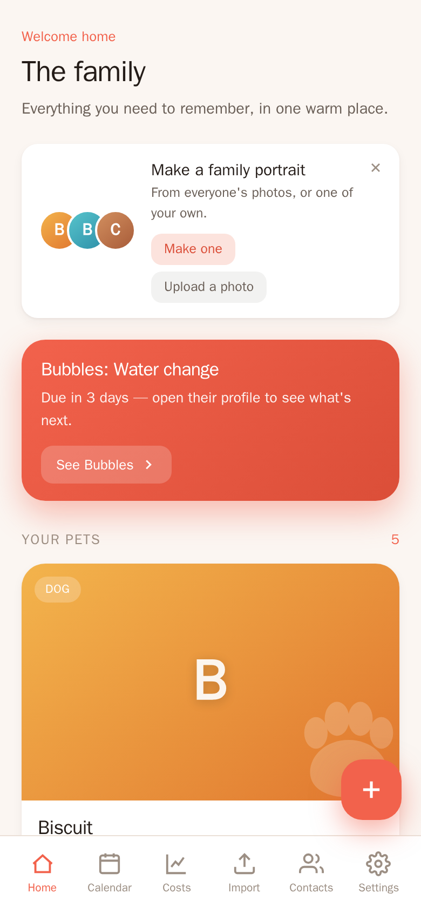
</p>

## Why

Pet-records apps (VitusVet, PetNoter, PetVitals) are cloud services you
cannot host yourself. Open-source pet software is veterinary *clinic*
practice management (OpenVPMS, Odoo modules), with billing, inventory and
staff roles a family does not need. FurFiles is the small, single-household,
own-your-data tracker in between.

## Features

- **Any species, many pets.** Dogs, cats, horses, birds, fish, reptiles. Each
  pet has a profile with the facts every vet intake form asks for: breed,
  sex, colour, birthday, gotcha day, microchip, weight. Sex wording follows the
  species (a horse reads stallion, mare or gelding), and a life stage (puppy,
  senior, foal, yearling...) is derived from the AAHA/AAFP guidelines.
- **Medical records** with notes (Markdown), cost, an itemised breakdown,
  custom fields, the clinic that saw them, and attachments (PDFs and photos
  open inline).
- **Ongoing care.** The food, preventatives, medications and supplements a
  pet is currently on, with amount and frequency. One product can cover
  flea, tick and heartworm at once.
- **Allergies** shown as a medical alert on the profile.
- **Reminders and a calendar.** Boosters, doses and appointments repeat on
  the calendar until marked done; each pet shows what is next.
- **Contacts and care teams.** Vets, emergency clinics, specialists,
  groomers, daycare and boarding, shared across pets, with hours and a
  facility's requirements (vaccines, paperwork) for drop-off day.
- **Costs and insurance.** Spending by category and pet, what insurance paid
  back, and per policy term the premium paid in against payouts and the
  break-even bill.
- **Optional AI document reading** (bring your own Anthropic API key, off by
  default). Scan an invoice or vaccine certificate into a pre-filled record,
  or drop a whole stack of documents on the Import page: each file is split
  into visits, assigned to the right pet, de-duplicated against what you
  already have, and nothing is saved until you review it. The key is stored
  encrypted and never shown again.
- **Archiving, done gently.** A pet who has passed is remembered; one who was
  rehomed is listed as a past companion. Nothing is deleted, and it is
  reversible.
- **Family portrait** on Home, uploaded or composed in the browser from your
  pets' photos.
- **API-first.** Everything the UI does goes through the same REST API under
  `/api`, so anything can be scripted.
- **Phone and desktop**, light and dark themes, installable as a web app.

| | | |
|---|---|---|
| 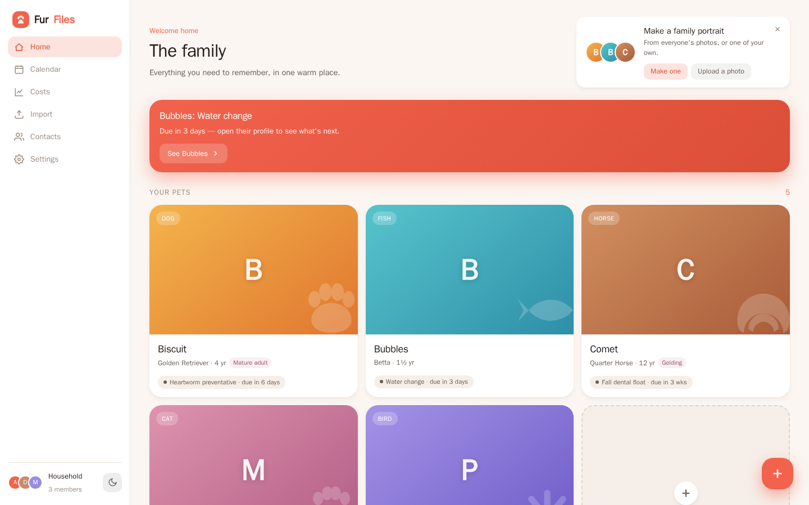 | 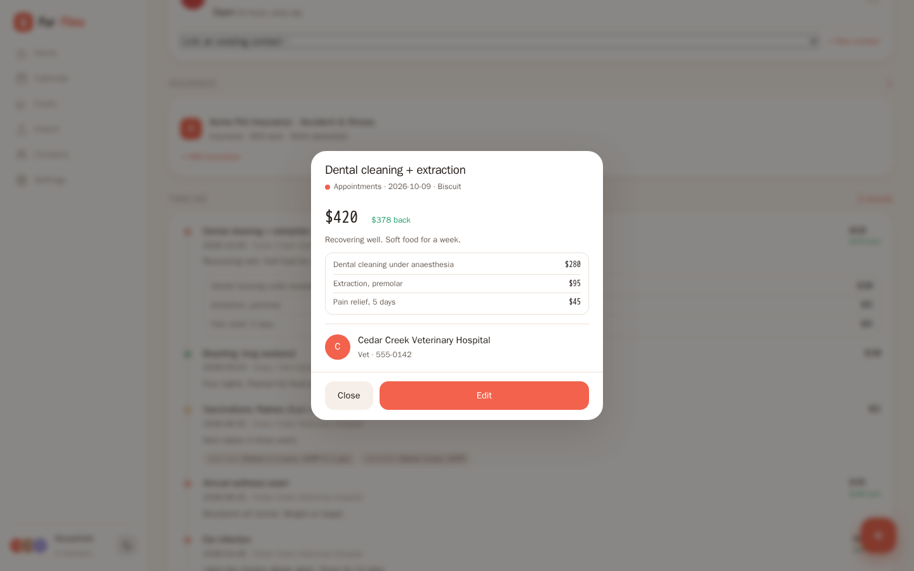 | 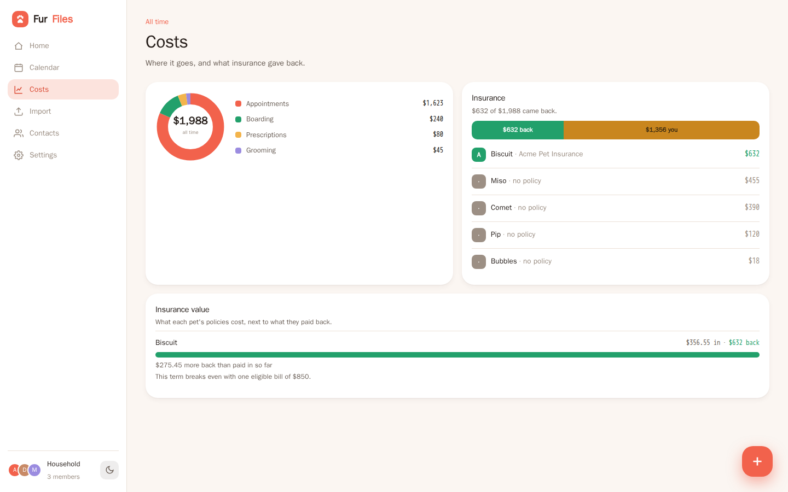 |
| 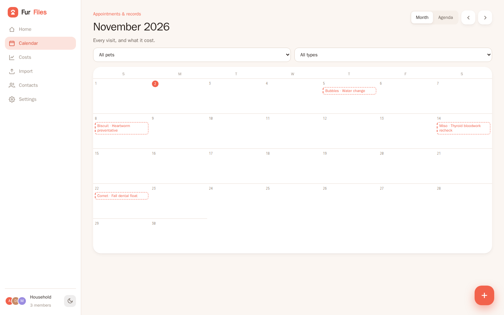 | 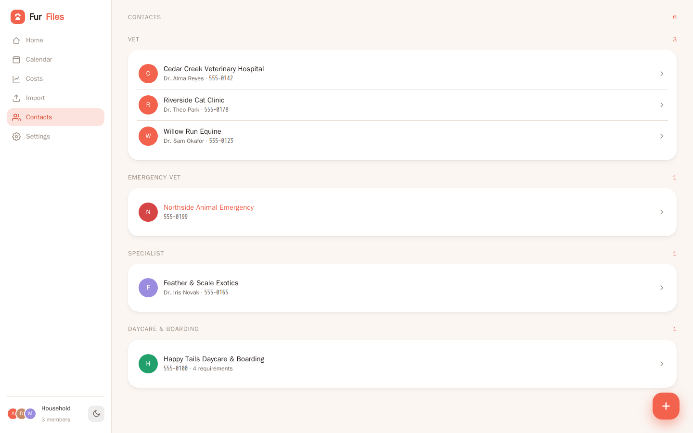 | 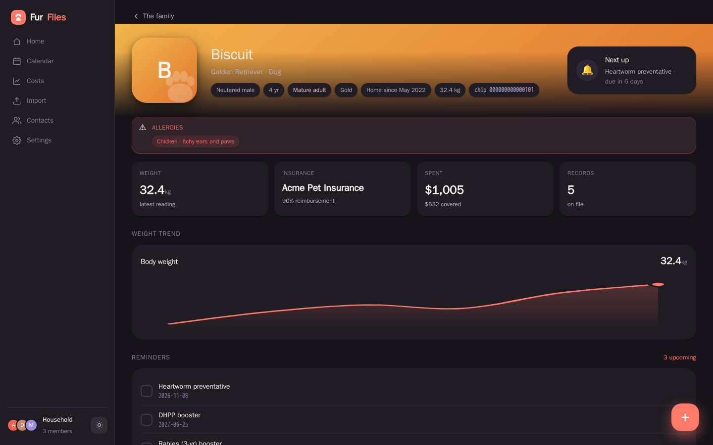 |

<p>
  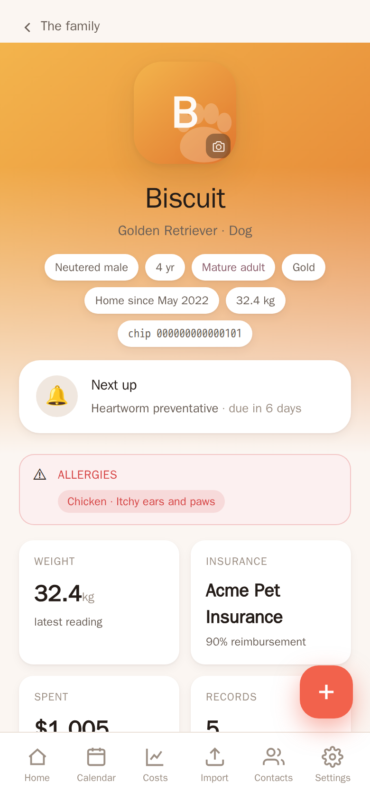
  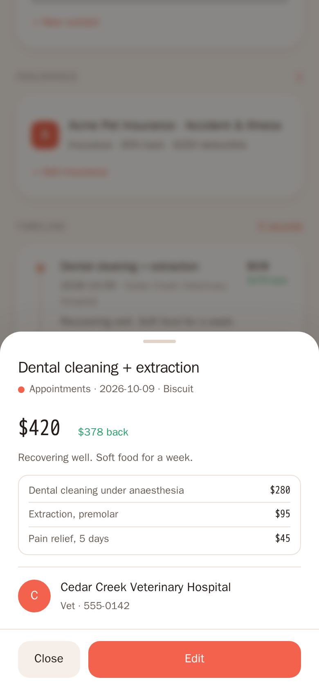
  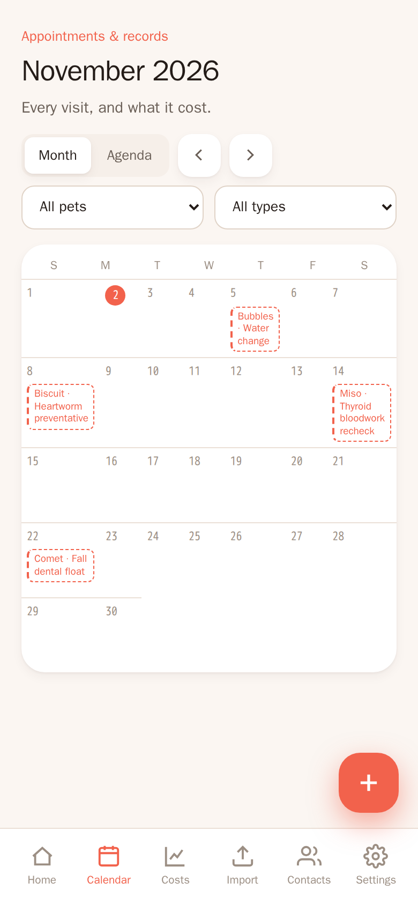
  
</p>

All screenshots show the built-in demo household; every name, number and
clinic in it is fictional.

## Quick start (Docker Compose)

```sh
git clone https://github.com/Jacob-Lasky/furfiles.git
cd furfiles
docker compose up -d
```

Open <http://localhost:8080>. Your data lives in `./data` next to
`compose.yaml`.

To build the image from your checkout instead of pulling it:
`docker compose up -d --build`. Settings go in a `.env` file next to
`compose.yaml` (see [Configuration](#configuration)); for example
`FURFILES_PORT=9000` publishes on a different port.

Image tags: `latest` and `X.Y.Z` follow releases, `edge` follows `main`.

### Plain `docker run`

```sh
docker run -d --name furfiles --restart unless-stopped \
  -p 8080:8080 \
  -v /path/to/furfiles-data:/data \
  --tmpfs /diag -e FURFILES_DIAG_DIR=/diag \
  ghcr.io/jacob-lasky/furfiles:latest
```

The image is `linux/amd64`. On another architecture, build it yourself:
`docker build -t furfiles .`

## Try the demo

Start FurFiles against an **empty** data directory with
`FURFILES_SEED_DEMO=1` and it fills itself with a fictional household:
five pets and one remembered, six clinics and facilities, visits with
itemised bills, vaccinations, medications, allergies, an insurance policy,
weight history and upcoming reminders. Dates are set relative to the day it
is seeded, so a fresh demo always has something due soon.

```sh
docker run --rm -p 8080:8080 -e FURFILES_SEED_DEMO=1 ghcr.io/jacob-lasky/furfiles:latest
```

(No volume, so it is thrown away when the container stops.) The demo only
seeds a database with no pets in it; it never touches existing data.

## Security

**FurFiles has no login yet** (multi-user accounts are planned). Anyone who
can reach the port can read and change everything. Run it on your home
network or a VPN, or put it behind a reverse proxy that adds authentication
(Authelia, Authentik, oauth2-proxy, basic auth). Do not expose it to the
internet as is.

## Configuration

All settings are environment variables; none are required.

| Variable | Default (in the image) | What it does |
|---|---|---|
| `FURFILES_PORT` | `8080` | Compose only: the host port to publish on. |
| `PORT` | `8080` | Port the server listens on inside the container. |
| `FURFILES_DB` | `/data/furfiles.db` | SQLite database path. Attachments and the key file go in the same directory by default. |
| `FURFILES_ATTACHMENTS` | `<db dir>/attachments` | Where uploaded documents and photos are stored. |
| `FURFILES_SECRET` | unset | Passphrase that encrypts the stored AI API key. If unset, a random key is generated at `<db dir>/furfiles-secret.key`. |
| `FURFILES_OWNER_NAME` | `Owner` | Household owner's display name, set the first time the database is created. |
| `FURFILES_SEED_DEMO` | off | `1` fills an empty database with the fictional demo household. |
| `FURFILES_DIAG_DIR` | a temp dir | Where in-app error reports are kept. Point it at a tmpfs so they are wiped on restart. |
| `FURFILES_STATIC` | `/app/static` | Built frontend to serve. |
| `RUST_LOG` | `furfiles=info,tower_http=warn` | Log filter. |

The AI document reader is configured in the app under **Settings**: paste an
Anthropic API key and pick a model. It is off until you do, and documents are
only sent to Anthropic when you ask for a scan or an import.

## Backup and restore

Everything FurFiles knows is in the data directory (`./data` with Compose,
`/data` in the container):

- `furfiles.db`: the SQLite database
- `attachments/`: uploaded documents, pet photos and the family portrait
- `furfiles-secret.key`: decrypts the stored AI key (not needed if you set
  `FURFILES_SECRET`; losing it only means re-entering the API key)

To back up, stop the container and copy the directory (the container writes
it as root, hence `sudo`):

```sh
docker compose stop && sudo tar czf furfiles-backup-$(date +%F).tgz data && docker compose start
```

To restore, stop FurFiles, put the directory back, and start it. For a backup
without stopping, use SQLite's online backup for the database
(`sqlite3 data/furfiles.db ".backup furfiles-copy.db"`) and copy the other
files alongside.

## Updating

```sh
docker compose pull && docker compose up -d
```

Database migrations run automatically on start and only ever add to the
schema. Take a backup first anyway.

## Development

- Backend: Rust + Axum + sqlx + SQLite, in `backend/`. `cargo test`, `cargo run`
  (serves on `:8080`; set `FURFILES_STATIC=../frontend/dist` to serve a built UI).
- Frontend: Vue 3 + Vite + TypeScript, in `frontend/`. Uses pnpm through
  corepack: `corepack enable && pnpm install && pnpm dev` (proxies `/api` to
  `:8080`), `pnpm test`, `pnpm run build`.
- CI runs both test suites on every pull request and publishes the image to
  `ghcr.io/jacob-lasky/furfiles` from `main` (`edge`) and from version tags.
- UI test anchors are listed in [`docs/frontend-testids.md`](docs/frontend-testids.md).

FurFiles is deliberately not clinic software: billing, inventory and staff
roles are out of scope. See the issue tracker for the roadmap.

## License

[MIT](LICENSE)
